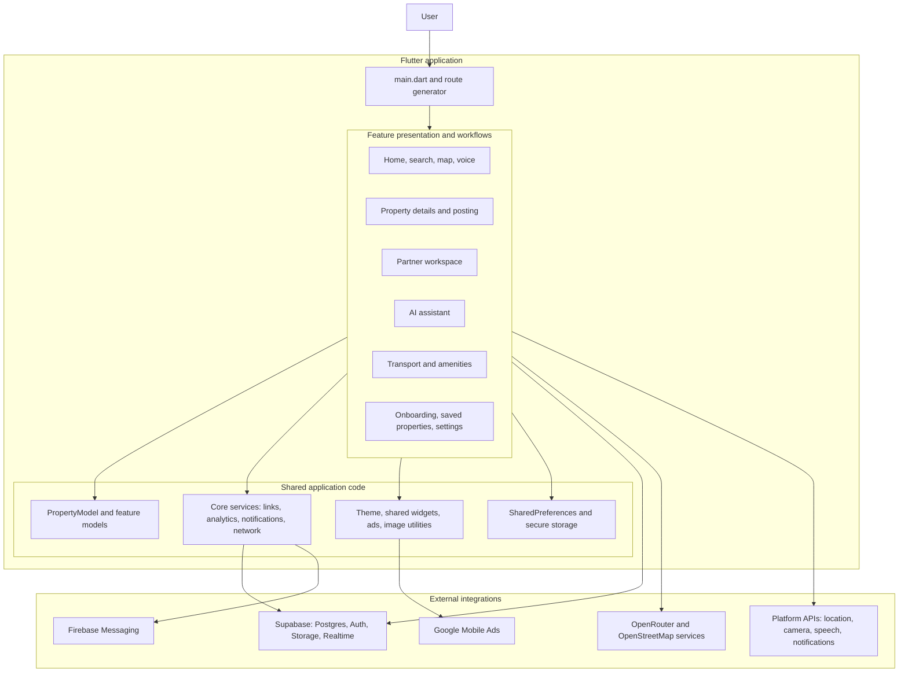
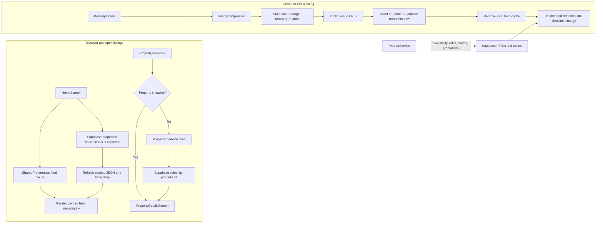

# Arkio Rental

Arkio Rental is a Flutter application for discovering and managing rental, PG/hostel, and buy/sell property listings. It includes a location-aware property feed, map and voice search, property details and owner contact actions, listing submission, a partner dashboard, nearby transport and amenities, an AI assistant, analytics, notifications, and web deep-link support.

The application identifier is `rental` in Dart (`pubspec.yaml`) and `com.arkiolabs.rental` on Android. The current package version is `1.1.18+28` (version name `1.1.18`, build number `28`).

## Contents

- [Technology and architecture](#technology-and-architecture)
- [Application startup and routing](#application-startup-and-routing)
- [Feature guide](#feature-guide)
- [Shared core](#shared-core)
- [Data and backend contracts](#data-and-backend-contracts)
- [Configuration and secrets](#configuration-and-secrets)
- [Run, test, and build](#run-test-and-build)
- [Platform setup](#platform-setup)
- [Repository map](#repository-map)
- [Known implementation notes](#known-implementation-notes)

## Technology and Architecture

### Stack

- **UI and runtime:** Flutter, Dart, Material, Cupertino widgets.
- **Backend and database:** Supabase Flutter client, Postgres, Supabase Storage, Supabase Auth, and optional Postgres Realtime subscriptions.
- **Local persistence:** `shared_preferences` for caches, saved listing IDs, location overrides, and some partner state; `flutter_secure_storage` for the persisted Supabase session, AI key, and AI chat history.
- **Location and maps:** Geolocator, Geocoding, `flutter_map`, and `latlong2`; nearby places are obtained from OpenStreetMap ecosystem endpoints.
- **Media:** Image Picker, Image Cropper, image compression utilities, cached network images, screenshots, QR generation, and Gal for saving media.
- **Device integrations:** Firebase Core/Messaging, device information, app links, speech recognition, URL launcher, permissions, in-app review/update, and Google Mobile Ads.
- **Web delivery:** Flutter web with path URL strategy and Vercel static hosting configuration.

### Architectural shape

The app uses a **feature-first folder structure** under `lib/features`. A feature typically owns its page-level UI and any data service or models specific to that workflow. Common property data, app configuration, theme, reusable services, ads, widgets, and utilities live under `lib/core` and `lib/app`.

This is not a strict repository/use-case Clean Architecture implementation: many screens call singleton services or Supabase directly, and some screens contain their own orchestration and form state. Most transient UI state is held by `StatefulWidget`; cross-screen or app-wide state is exposed by singleton `ChangeNotifier` services such as `SavedPropertiesService`, `PartnerService`, and `ThemeController`.

### Architecture diagram

This diagram shows the main ownership boundaries. Feature screens may use a feature service or call a shared integration directly, depending on the workflow; there is no universal repository layer.



### Top-level source layers

- `lib/main.dart` bootstraps plugins and services, configures global error handling, creates the `MaterialApp`, and owns the route generator.
- `lib/app/config` contains build-time environment values.
- `lib/app/theme` defines theme colors, theme data, and the persisted theme controller.
- `lib/features/<feature>/presentation` contains pages and widgets for user workflows.
- `lib/features/<feature>/data` contains feature-specific services and serializable models.
- `lib/core/models` contains the shared property model used across features.
- `lib/core/services`, `lib/core/ads`, `lib/core/widgets`, and `lib/core/utils` contain cross-feature behavior.

## Application Startup and Routing

### Startup sequence

1. `main()` initializes Flutter bindings, enables path-based web URLs, installs Flutter and async error handlers, enables edge-to-edge system UI, and increases Flutter's image cache limits.
2. Firebase initialization, Android install tracking, and AI assistant local initialization are started without blocking the first frame.
3. SharedPreferences is read for the property feed cache and onboarding/install flags.
4. The initial link is inspected before `runApp()`. On web, the current browser URL is used; on mobile, `app_links` reads the initial URI. The initial link is not given an application-level timeout.
5. If the link contains a property ID, the route generator tries the cached property JSON first. A hit opens the property detail page; a miss opens the property loader directly.
6. `RentalApp` is launched. With no property link, the default route is `OnboardingScreen`.
7. After the first frame is allowed to render, remaining work initializes the theme controller, saved properties, Supabase, AdMob, analytics, push notifications, the incoming-link listener, and (on web) the install prompt.

Initialization errors are generally caught and logged so optional integrations do not prevent the UI from starting. Supabase-backed screens still require a reachable and correctly configured Supabase project to load remote data.

### Startup and deep-link sequence

```mermaid
sequenceDiagram
  actor User
  participant Main as main()
  participant Local as SharedPreferences
  participant Links as AppLinks / browser URL
  participant Router as MaterialApp route generator
  participant Cache as Property cache
  participant Loader as PropertyLoaderScreen
  participant DB as Supabase
  participant UI as App screens
  participant Async as Background services

  User->>Main: Launch app or open property URL
  Main->>Main: Initialize Flutter and global handlers
  Main->>Local: Read cached properties and onboarding flags
  Main->>Links: Resolve initial URI
  Links-->>Main: URI or no property link
  Main->>Router: runApp with initial link and cache
  alt URI identifies a property and cache contains it
    Router->>Cache: Find cached PropertyModel
    Cache-->>Router: PropertyModel
    Router->>UI: Show PropertyDetailsScreen
  else URI identifies property but cache misses
    Router->>Loader: Open loader directly
    Loader->>Local: Check stored property cache
    alt Still not found locally
      Loader->>DB: Select one property by ID (6-second timeout)
      DB-->>Loader: Property row or failure
    end
    Loader->>UI: Replace loader with details or show error
  else No property link
    Router->>UI: Show OnboardingScreen
  end
  Main-->>Async: Initialize Supabase, theme, saved items, ads, analytics, push, links
```

### Route behavior

`RentalApp` uses `MaterialApp.onGenerateRoute` in `lib/main.dart`:

- `/ai`, `/ai-chat`, and `/assistant` open `AiChatScreen`.
- A property ID extracted from the route URI or initial launch URI opens `PropertyDetailsScreen` when present in the cached property list; otherwise it opens `PropertyLoaderScreen`.
- Any other initial route opens `OnboardingScreen`.
- The `MaterialApp` navigator key is shared with push-notification navigation.

`DeepLinkService.extractPropertyId` accepts IDs in query parameters named `propertyId`, `id`, or `property_id`, and path forms such as `/property/<id>`, `/p/<id>`, and `/listing/<id>`. Incoming links while the app is running are handled by the `app_links` URI stream; duplicate navigation is suppressed.

Supported formats include:

```text
https://rental.arkio.in/?propertyId=<id>
https://rental.arkio.in/property/<id>
rental://property/<id>
arkio://rental/property/<id>
```

### Property loading and cache behavior

- The home feed reads `cached_properties` from SharedPreferences before requesting fresh results. The property JSON is parsed off the UI isolate, and the first few listing images are precached.
- The feed cache has a version guard (`_cacheVersion` in `HomeScreen`) and a five-minute freshness window. A schema version change invalidates the old feed cache.
- Deep-link loading tries the startup cache, web-preloaded property data, and SharedPreferences before selecting a single property from Supabase. The remote fallback has a six-second timeout.
- Transport results are requested alongside property details and have their own Supabase/local caches.
- Saving or editing listing data invalidates the feed cache so subsequent screens refresh.

### Property data lifecycle



The cache makes the first feed render faster, but remote refresh remains the source of current approved listings. Listing uploads and edits write remotely first and invalidate the local feed cache after success.

## Feature Guide

### Home and property discovery

**Location:** `lib/features/home/`

`HomeScreen` is the main discovery feed and owns the active location, category selection, search entry points, filters, map/list presentation, cached listings, location stream, and Supabase live updates. It loads approved rows from `properties`, applies location-aware sorting and category/filter state, and listens to changes in `properties` and `property_promotions`. The feed also retrieves currently active promotions and can render sponsored/ad items.

The location flow combines a Geolocator position stream (15-metre movement filter), reverse geocoding, saved manual location overrides, and a location picker. A manually selected location is persisted locally and can be cleared to return to device location. UI components include property cards, grid cards, filter sheets, loading skeletons/shimmer, location/logo switchers, and the yellow splash/loading presentation.

### Onboarding

**Location:** `lib/features/onboarding/presentation/pages/onboarding_screen.dart`

`OnboardingScreen` handles the initial splash/location experience and transitions into the app's discovery flow. It tracks the location permission/result state and uses persisted onboarding/install information read during startup. Its presentation includes location-progress and permission states rather than being only a static welcome page.

### Search, map, and voice

**Location:** `lib/features/search/`

- `UnifiedSearchScreen` supports free-text property search, categories, popular/recent search suggestions, location suggestions, and property results. It can receive an initial property list from the caller.
- `SearchScreen` provides the more detailed category and attribute filter experience, including listing-specific filters.
- `MapScreen` presents listings in a map context using `flutter_map` and `latlong2`.
- `LocationPickerSheet` lets a user choose a location from a map/location workflow.
- `VoiceSearchScreen` uses `speech_to_text` and routes recognized text into search.
- `MapsImportService` resolves/parses Google Maps URLs where possible and can ask OpenRouter to extract draft listing details. URL coordinates take priority over AI-provided coordinates. AI extraction requires an OpenRouter key; on web, following short-link redirects is skipped because of browser CORS restrictions.

### Property details

**Location:** `lib/features/property_details/`

- `PropertyLoaderScreen` resolves a property ID through in-memory/SharedPreferences/web preload paths and then Supabase. It displays loading and not-found/network-failure states before replacing itself with the detail page.
- `PropertyDetailsScreen` renders listing photos, type-specific facts, rent/financial information, amenities, PG or rental-specific details, owner contact, nearby listings, availability actions, and review information.
- Detail actions include sharing, QR poster generation, call/WhatsApp/directions actions, property-view/action analytics, submitting reviews, contributing photos, and reporting incorrect or problematic listing information.
- Nearby transport and amenity features provide distance-sorted places and links to map/directions/street-view experiences. Nearby transport is requested by property details; the nearby-essentials section in that screen is currently disabled by `_showNearbyEssentials = false`. The amenity service and street-view page are implemented under `features/amenities`.
- Supporting sheets/widgets include share options, QR poster, contributed-photo status, and property analytics service integrations.

### Property posting and editing

**Location:** `lib/features/property_posting/`

`PostingScreen` is a six-step listing form supporting PG/hostel, rental, and buy/sell property variants. The steps collect the listing type, photos and basics, space/room specifications, category-specific utilities or food details, rules/ownership details, and contact/review information. The screen can also be opened with an existing property for editing.

`PhotoPositionScreen` supports arranging/selecting photos; `AreaCalculatorMapScreen` assists with map-based area/location work. `PropertyPostingStatusSheet` compresses selected images, uploads them to the Supabase Storage bucket `property_images`, then inserts a new row into `properties` or updates an existing row. New submissions use `pending` status. Edits preserve the existing listing status and try the `update_property_listing` RPC before falling back to a direct update. If a partner is signed in locally, partner metadata is added to tags. Successful writes clear the cached feed; drafts use local persistence while the user is working.

### Saved properties

**Location:** `lib/features/saved_properties/`

`SavedPropertiesService` stores a set of property IDs under `saved_properties_ids` in SharedPreferences and notifies listeners when IDs change. This is a device-local feature: it is not a server-side favorites list and does not synchronize between devices. `SavedPropertiesScreen` displays the saved listings available to the current app state.

### Partner and property-owner workspace

**Location:** `lib/features/partner/`

The partner area includes an entry handler, onboarding, email/password sign-in and sign-up UI, a dashboard, and tabs for overview, properties, analytics, promotions, and profile. Partner workflows include:

- Viewing properties associated with the partner through partner tags/IDs/email, owner phone matching, approved handover requests, or promotions.
- Editing property details and toggling availability (RPC first, direct table update fallback).
- Submitting a handover/claim request for an existing listing. Requests are stored locally and submitted as `listing_reports` rows for review.
- Creating and managing in-app or external promotion requests in `property_promotions`; newly created requests are marked pending for approval.
- Viewing property performance metrics assembled by `PropertyAnalyticsService`.
- Receiving partner notifications from the partner notification service's local cache.

Partner data models are `PartnerPromotionModel`, `PartnerNotificationModel`, and `PartnerHandoverRequest`. The singleton `PartnerService` coordinates partner state, listing lookups, requests, promotions, and analytics.

**Authentication note:** the current partner implementation has a local account registry in SharedPreferences and attempts Supabase Auth as an additional path. The local registry includes account credentials and is not a production-grade secure identity store; see [Known implementation notes](#known-implementation-notes).

### AI assistant

**Location:** `lib/features/ai_chat/`

`AiChatScreen` presents the chat UI. `AiAssistantService` maintains a local property context synchronized from Supabase, conversation history, and an optional custom OpenRouter key. It tries an OpenRouter chat completion with the available listings as context; when the key/service is unavailable it uses an in-app conversational fallback. Message history and the custom key are saved through secure storage. The service limits retained history to 100 messages and associates recommended listing IDs with cached `PropertyModel` objects.

The API key can be provided as a build-time `OPENROUTER_API_KEY` or entered/stored by the user. A key compiled into a client application can be extracted; production deployments should proxy privileged AI requests through a trusted server.

### Nearby amenities and transport

**Locations:** `lib/features/amenities/` and `lib/features/transport/`

`AmenityService` and `TransportService` find nearby locations, normalize and filter results, compute Haversine distances, and return typed place models. Data acquisition uses OpenStreetMap-related services (including Nominatim/Overpass and fallback place sources in the implementations). Results are checked in Supabase cache tables and local SharedPreferences before remote fetches; cache entries expire after 14 days. The pages expose place details and map/street-view/directions links. These external services have their own network availability and usage policies.

### Settings

**Location:** `lib/features/settings/presentation/pages/settings_screen.dart`

`SettingsScreen` contains app-level settings and entry points for preferences and app information. Theme data is defined in `AppTheme`; however, current runtime wiring forces the app to light mode (`MaterialApp.themeMode` and `ThemeController` both report light mode). Do not assume a working dark-mode toggle solely because light and dark theme definitions exist.

## Shared Core

### Shared property model

`lib/core/models/property_model.dart` defines `PropertyModel`, the common representation used by the feed, search, details, posting, and partner features. It maps between Dart fields and snake_case Supabase JSON. Core values include ID, title, price, location text and coordinates, photos, tags, beds/baths/area, property type, owner contact, features, availability, listing status, description, reviews, suggested photos, and view count.

Category-specific fields cover:

- **Money and lease terms:** security deposit, maintenance charges, notice period, agreement duration, and per-day PG rates.
- **PG/hostel:** food menu, gender preference, sharing type, food plan/quality, drinking water, water supply, backup power, AC, bathrooms, cleaning, security, verification, management, and gate rules.
- **Rental:** BHK, furnishing, plumbing/seepage/electrical/meter condition, bills, tenant preference, pets, and parking.
- **Partner attribution:** partner ID, email, role, and listing view count.

The model sanitizes a few known encoding artifacts and can infer partner metadata from tags when explicit columns are absent. Equality uses ID when available, otherwise title/price/location.

### Cross-cutting services

- `DeepLinkService`: parses property and assistant links, handles initial/runtime app links, resolves cached properties, and deduplicates navigation.
- `AnalyticsService`: registers device/FCM details in Supabase and records general events such as listing views, searches, and category interactions.
- `PropertyAnalyticsService`: records property views, dwell time, calls, WhatsApp, shares, and directions; aggregates partner analytics.
- `PushNotificationService` and `NotificationBroadcastService`: handle Firebase message opens, broadcast notification payloads, local history, and action navigation.
- `NetworkStatusService`: tracks connectivity/reporting outcomes; `NetworkTopBar` and its wrapper display network state.
- `InAppUpdateService`: wraps supported-platform update checks; `ReviewTriggerService` tracks app usage and triggers review prompts.
- `InstallTracker`: creates an Android install identifier and upserts install/open timestamps to Supabase.
- `AppInstallPromptService`: manages a web-only install prompt and its display history.
- `SecureLocalStorage`: adapts `flutter_secure_storage` for Supabase Auth session persistence.
- `ImageCompressor`: compresses image bytes off the UI thread for listing uploads.
- `AdsInitializer`, `ad_config.dart`, and ad widgets: initialize AdMob and render banner, native, and in-feed ad placements. Ads are controlled by the `adsEnabled` constant and configured with unit IDs in source.
- `core/widgets`: shared image viewing/cropping, loading/network/error/status UI, app icon, snackbars, and button components.

## Data and Backend Contracts

The app expects a Supabase project with schema, policies, functions, storage, and (where enabled) Realtime configured to match the following usage. This repository does not include a complete SQL schema or migration set; the names below are inferred from actual client calls and are not a substitute for backend migrations.

| Backend object | Purpose in the client |
| --- | --- |
| `properties` | Property feed, search context, property detail lookup, posting/editing, partner property lookup. Home feed selects rows where `status = approved`. |
| `property_promotions` | Partner promotion requests and active feed promotion data; home listens for changes. |
| `listing_reports` | Listing reports and partner handover/claim requests. |
| `property_analytics_events` | Property view, dwell-time, and action events used by partner analytics. |
| `devices` | Device/FCM token registration and general event activity timestamps. |
| `analytics_events` | General app analytics events. |
| `device_installs` | Android install and last-open tracking. |
| `transport_cache` | Shared nearby transport cache. |
| `amenities_cache` | Shared nearby amenities cache. |
| `broadcast_notifications` | Broadcast notification history. |
| Storage bucket `property_images` | Uploaded property and contributed-review photos. |

RPCs called by the client:

- `increment_property_views`: atomically increments property views and may return the updated count.
- `toggle_availability`: updates property availability for partner management.
- `update_property_listing`: updates listing data; clients fall back to a direct table update if the RPC fails.

The home feed subscribes to Postgres changes for `properties` and `property_promotions`. Supabase Row Level Security (RLS), grants, bucket policies, and RPC permissions must allow the intended client operations. Since the app embeds a Supabase anon/public key, authorization must be enforced by backend policies and never by treating that key as a secret.

## Configuration and Secrets

Build-time values are read in `lib/app/config/env.dart`:

| Define | Required for | Notes |
| --- | --- | --- |
| `SUPABASE_URL` | Remote listings, partner data, analytics, and caches | The source currently has a project URL fallback; deployments can override it. |
| `SUPABASE_ANON_KEY` | Supabase client access | The source currently has a public anon-key fallback; provide the matching project's public key at build time when changing environments. This is not a service-role key. |
| `OPENROUTER_API_KEY` | AI chat and Maps-link AI extraction | Optional. Without it, chat uses fallback responses and Maps import cannot perform AI extraction. |

Example local build using a local, ignored `env.json`:

```json
{
  "SUPABASE_URL": "https://your-project.supabase.co",
  "SUPABASE_ANON_KEY": "your-public-anon-key",
  "OPENROUTER_API_KEY": "your-openrouter-key"
}
```

Do not commit `env.json`, private API keys, service-role keys, signing credentials, or Firebase service configuration. `env.json`, `.env*`, `google-services.json`, `GoogleService-Info.plist`, and secret files are ignored by `.gitignore`.

The Vercel `build.sh` script creates `env.json` from the `SUPABASE_URL`, `SUPABASE_ANON_KEY`, and `OPENROUTER_API_KEY` environment variables, then builds Flutter web with `--dart-define-from-file=env.json`. Configure those values in the Vercel project environment settings. The web Firebase options are currently embedded in Dart source; review and replace them when switching Firebase projects.

## Run, Test, and Build

### Prerequisites

- Flutter SDK on the stable channel, compatible with the Dart constraint `^3.12.1` in `pubspec.yaml`.
- Android Studio/Android SDK for Android builds.
- Xcode and CocoaPods on macOS for iOS builds.
- A configured Supabase project for server-backed flows.
- Firebase project/platform configuration for native push-notification behavior.

### Common commands

```sh
flutter pub get
flutter run
flutter analyze
flutter test
flutter build apk
flutter build appbundle
flutter build web --dart-define=SUPABASE_URL=https://your-project.supabase.co --dart-define=SUPABASE_ANON_KEY=your-public-anon-key --dart-define=OPENROUTER_API_KEY=your-openrouter-key
```

On Windows, run these commands in PowerShell from the repository root. `flutter build ios` is only available on macOS with Xcode. For local web builds, `flutter build web --dart-define-from-file=env.json` can be used when `env.json` has been created locally.

### Tests and quality checks

The tests in `test/` currently cover:

- `widget_test.dart`: a placeholder smoke test that only asserts `true`.
- `partner_dashboard_test.dart`: construction of the partner dashboard with mocked SharedPreferences and attempted Supabase initialization.
- `partner_tabs_test.dart`: construction checks for the partner home, properties, analytics, promote, and profile tabs.

These are widget-construction checks, not end-to-end, backend, data-integrity, or deep-link integration tests. Running `flutter test` does not validate production Supabase policies, Firebase delivery, native links, or remote API availability.

## Platform Setup

### Android

- Application ID/namespace: `com.arkiolabs.rental`.
- The manifest requests network state, phone, location, camera, microphone, notification, and advertising ID permissions.
- The activity uses `singleTop`; Flutter's built-in deep linking is disabled so `app_links` and `DeepLinkService` own the flow. HTTP(S) App Links for `rental.arkio.in` and `rental://`/`arkio://` custom schemes are declared in `AndroidManifest.xml`.
- Google Mobile Ads app ID and the default FCM notification channel are declared in the manifest.
- Android is configured for Java/Kotlin 17 and compile SDK 36. Release signing reads `android/key.properties`; keep that file and its keystore private.
- Add the Firebase `google-services.json` for the correct Android application to `android/app/` and verify the Google Services Gradle plugin/project registration when enabling native Firebase services. That file is not present in this checkout.

### iOS

- `Info.plist` declares location, photo library, camera, microphone, and speech-recognition purpose strings, plus URL schemes `rental` and `arkio`.
- `Runner.entitlements` declares the `applinks:rental.arkio.in` associated domain. The web domain must also serve a valid Apple App Site Association file for Universal Links.
- Add the Firebase `GoogleService-Info.plist` for the correct iOS bundle identifier when enabling native Firebase services. That file is not present in this checkout.
- Build and sign with Xcode on macOS.

### Web and Vercel

- `web/index.html` provides the app shell, metadata, manifest reference, and browser-side splash/property preview support.
- `usePathUrlStrategy()` enables path URLs. `vercel.json` serves existing static files and falls back to `index.html` for app routes.
- `build.sh` installs Flutter stable in the build environment, enables web, creates the environment define file, builds into `build/web`, and copies `app-ads.txt` when available.
- For Vercel deployment, configure the three environment variables above. Vercel runs `bash build.sh` and publishes `build/web`.
- The shell build script is intended for a Bash build host (such as Vercel/WSL), not direct PowerShell execution.

## Repository Map

```text
lib/
  main.dart                         Startup, global wrappers, routing
  app/
    config/env.dart                 Build-time configuration
    theme/                          Theme definitions and controller
  core/
    ads/                            Ad configuration, initialization, placements
    models/property_model.dart      Shared property data contract
    services/                       App-wide integrations and lifecycle services
    utils/                           Image compression and other shared utilities
    widgets/                         Reusable app-wide widgets
  features/
    ai_chat/                         AI chat UI and service
    amenities/                       Nearby amenity service and street-view UI
    home/                            Discovery feed and feed widgets
    onboarding/                      Initial location/onboarding flow
    partner/                         Partner/owner portal, models, and services
    property_details/                Listing detail, loader, analytics, sharing
    property_posting/                Create/edit listing and image workflow
    saved_properties/                Local saved-listing service and screen
    search/                           Search, map, voice, location picker, map import
    settings/                         Settings screen
    transport/                        Nearby transport service and street-view UI
assets/
  animations/                        Lottie animations
  images/                             App/property imagery
  Icons/                              Packaged icons (directory capitalization matters)
  theme/                              Theme-specific assets
android/                              Android app, manifest, resources, Gradle
ios/                                  iOS Runner, entitlements, Xcode project
web/                                  Flutter web shell, manifest, icons, app-ads.txt
test/                                 Flutter widget tests
build.sh                              Vercel/Bash Flutter web build script
vercel.json                           Vercel build/output and SPA routing
pubspec.yaml                          Dependencies, assets, version, launcher icons
analysis_options.yaml                 Flutter lint configuration
```

Notable module files:

- **Home:** `home_screen.dart`, `property_card.dart`, `grid_property_card.dart`, `filter_bottom_sheet.dart`, skeleton/shimmer widgets, and location presentation widgets.
- **Search:** `unified_search_screen.dart`, `search_screen.dart`, `map_screen.dart`, `voice_search_screen.dart`, `location_picker_sheet.dart`, and `maps_import_service.dart`.
- **Property details:** `property_loader_screen.dart`, `property_details_screen.dart`, `property_analytics_service.dart`, share/QR/photo-contribution widgets, and web preloader implementations (`web_preloader.dart`, web, and stub variants).
- **Posting:** `posting_screen.dart`, `photo_position_screen.dart`, `area_calculator_map_screen.dart`, and `property_posting_status_sheet.dart`.
- **Partner:** `partner_service.dart`, partner models/services, dashboard/auth/onboarding/entry pages, five dashboard tabs, and claim/edit/promotion/notification widgets.
- **Shared services:** `deep_link_service.dart`, `push_notification_service.dart`, `notification_broadcast_service.dart`, `analytics_service.dart`, `network_status_service.dart`, `in_app_update_service.dart`, `review_trigger_service.dart`, and `install_tracker.dart`.

## Known Implementation Notes

- PartnerService currently keeps a local account registry, including passwords, in SharedPreferences. SharedPreferences is not encrypted. Do not use this local mechanism for real user credentials; use a properly secured server-backed identity flow before production use. The service also seeds a local demo owner account in code.
- A Supabase anon key is designed to be public, but safe access depends on correct RLS and Storage policies. Never place a Supabase service-role key in the Flutter client.
- An OpenRouter key supplied as a Flutter compile-time define is bundled into the client. For a commercial deployment, call the AI provider through a server-side endpoint with rate limits and authorization.
- The repository does not currently contain `google-services.json` or `GoogleService-Info.plist`. Native Firebase messaging/analytics therefore needs platform setup before it can be relied upon. Firebase initialization errors are caught, so missing setup may appear as unavailable optional behavior rather than a startup crash.
- Some operations have local fallbacks, while others require Supabase (for example, fresh property feed queries and listing uploads). Local caches improve startup but do not make all app features offline-capable.
- Theme files define both light and dark palettes, but current app wiring forces light mode.
- The README documents client-observed backend contracts. Keep this guide synchronized with Supabase migrations, RPC signatures, policies, or a future backend schema repository.


